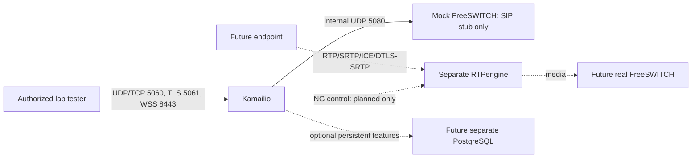

# Architecture and production gaps

## ขอบเขตที่ทำงานจริงกับเป้าหมาย

นี่คือ production-oriented **development lab** ไม่ใช่ production SBC สำเร็จรูป
ตรวจ Workspace ใหม่แล้วพบเพียง README เดิม ไม่มีไฟล์ Lab เดิม จึงสร้างใหม่
ไม่ใช่การกู้คืนไฟล์ ไม่มีการแก้ root README, GitHub Actions หรือ AWS

Lab ใช้ bridge สอง network: external สำหรับ tester, internal แบบ internal:true
สำหรับ mock backend; Kamailio มี IP ในแต่ละ network และ bind socket คนละ IP/port
IP ถูก resolve จาก Docker DNS ไม่ hardcode ตัวเลขที่สมมติว่าเป็น AWS จริง
นี่คือ Linux virtual interfaces/bridge ไม่ใช่ AWS ENI สองใบ
external network ยังมี Docker outbound access ไม่ใช่ public ingress
internal port ไม่ publish บน host; Docker administrator ยังเข้าถึงได้

| Protocol | Container port | Host binding | Purpose |
|---|---:|---|---|
| SIP UDP/TCP | 5060 | 127.0.0.1:15060 | Lab ingress; host gateway is not trusted |
| SIP TLS | 5061 | 127.0.0.1:15061, TLS override only | Verified lab TLS |
| WSS | 8443 | 127.0.0.1:18443, TLS override only | /sip, exact Origin policy |
| Internal SIP UDP/TCP | 5080 | none | backend network only |
| RTPengine NG | 2223 UDP | none | standalone userspace test only |
| RTP test range | 30000–30020 UDP | none | not connected to SBC/media clients |
| Database | not enabled | none | deferred |

## Routing, ownership, and safety

Source IP authorization is derived from the named isolated tester and backend.
It is NOT an Internet authentication design. A compromised trusted container can
originate allowed lab traffic. REGISTER always rejected; no authoritative
registrar exists in this lab. Before enabling registration decide whether
FreeSWITCH owns subscriber auth/registration (recommended initial design) or
Kamailio owns registrar/usrloc and a secure subscriber DB. Never turn on digest
registration without that decision and verified credential storage.

Sanity, Max-Forwards, source allowlist, destination domain allowlist, transaction
handling, cancellation and Record-Route are implemented. Dispatcher uses a local
list with a single backend, not DB. INVITE receives 486 from the mock; there is
no successful call/dialog/media test. In-dialog forward routing is constrained
to the known backend; reverse dialog origination is deliberately denied.
This is not yet bidirectional FreeSWITCH call interoperability. Public providers
must be individually classified by verified CIDR/mTLS identities, dialplan,
allowed numbers, concurrency/rate limits, and cost policies before exposure.

TM handles transactions and failure responses. Multi-node design: configure
multiple dispatcher destinations, OPTIONS probing and failure_route selection
with ds_next_dst/t_relay; cap retries, avoid retrying accepted transactions,
test failure/recovery and CANCEL races. Probing is OFF with a mock backend;
no HA or operational health-based failover is claimed.

## AWS routing design (not applied)

For a single EC2 host, host networking plus explicit external/internal listen
addresses is normally simplest for SIP/media port preservation. It removes
Docker port NAT but requires strict host firewall, SGs, and interface binding.
External TLS FQDN/cert, actual EC2 private addresses, EIP NAT mapping, provider
CIDRs, browser Origin/auth ownership and FreeSWITCH routes remain required.
Configure external advertise address/EIP and internal private advertise address
per Kamailio socket; never advertise bridge RFC1918 contacts to public clients.
Select outgoing socket for each route leg; validate Record-Route, Via, Contact,
SDP and return paths from captures. Do not copy lab Docker IPs into AWS config.

A second physical NIC requires a confirmed ENI attachment/subnet, source-based
routing, symmetric return routing, source/destination-check review where
applicable, and SGs for each ENI. None is assumed or created here. Macvlan/ipvlan
can preserve L2 identities on supported networks but complicates host access and
is not a default solution for AWS VPC ENI address restrictions. Bridge works for
this isolated lab; production bridge additionally needs explicit SIP/SDP NAT
advertisement and media range mappings. No host networking changes were made.

## TLS and WebSocket

`compose.tls.yaml` enables TLS/WSS only, never plain WS. Test CA is a disposable
local identity, not a public production certificate. Client tests validate CA
chain and hostname; Kamailio outbound TLS config validates peer chains. Server
does not require client certificates because browser WSS cannot rely on mTLS;
source/Origin policy here is a LAB substitute, not user authentication.
TLSv1.2+ selects supported TLS 1.2/1.3 with OpenSSL; successful default handshake
does not by itself test every protocol/cipher version. HTTP path /sip and exact
Origin https://lab.invalid are required. WSS registration remains disabled.

Production: inject real full-chain certificate and private key read-only outside
image, restrict key to runtime UID/GID, define domain/SNI policy, and require
verified browser identity bound to the SIP flow plus per-account permissions.
Renew atomically, validate chain/expiry/permissions, run config check, then
controlled restart (existing dialogs/connections may be interrupted); tls.reload
requires a separately secured RPC interface and its semantics must be tested
before using zero-downtime claims. Never mount a management RPC publicly.

## Media and RTPengine

Kamailio handles signaling only. Separate RTPengine userspace image uses
--table=-1, unprivileged user and no kernel modules, capabilities or iptables
setup. Debian package requires codec libraries, but installed libraries are NOT
proof a particular transcoding path works. Upstream license is GPLv3; Debian
copyright file in the image covers linked components; review redistribution and
codec/patent obligations separately before shipping images.

Future anchoring: offer/answer branches must call the rtpengine module with
explicit interface directions, appropriate replace-origin/replace-session-
connection, ICE policy and RTP profile bridging. WebRTC leg generally uses
UDP/TLS/RTP/SAVPF, ICE and DTLS-SRTP; SIP leg depends on backend RTP/SRTP support.
Do not hardcode a single flag set for every trunk. Delete media sessions on BYE,
CANCEL and final failures. Restrict NG control network; never publish it.

Direct media is possible only if both endpoints have compatible codecs/security
and mutually reachable negotiated candidates, and policy permits bypassing the
anchor. It does not make Kamailio a media relay. No WebRTC audio, SDP conversion,
DTLS negotiation, ICE/NAT traversal, or transcoding is claimed tested here.

## Module decisions

See module-evidence.txt for actual package ownership and missing libraries.
Loaded baseline: pv, tm, sl, rr, maxfwd, sanity, textops, siputils, xlog,
dispatcher. TLS profile additionally tls, xhttp, websocket.
Available in image but deferred: nathelper/path (registration/flow ownership),
permissions (production ACL source), pike/htable (reviewed flood limits), dialog
(dialog quotas), acc (privacy-reviewed accounting), rtpengine (SDP/media phase).
Do not enable a module merely because its .so exists. db_postgres/db_mysql are
not in this image; Bookworm lists kamailio-postgres-modules 5.6.3-2 explicitly.
No database driver is necessary for this single-backend file-based SBC lab.

Outbound is NOT installed. Debian package inspection confirms outbound.so in
kamailio-outbound-modules=5.6.3-2; db_postgres/db_mysql are separate matching
packages as well. See optional-modules.txt for SHA256-verified file listings
and package dependencies, without installing unnecessary modules.
